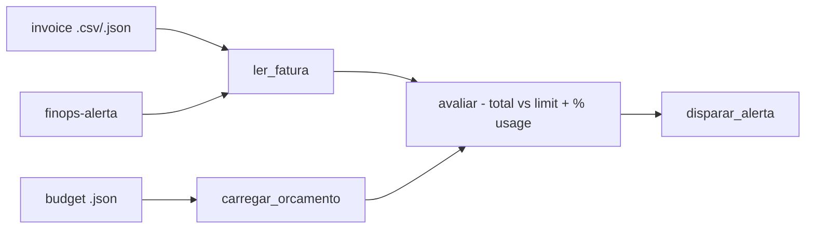

# finops-alerta-orcamento

**English** · [Português (Brasil)](README.md)

[](#) [](#) [](LICENSE)

## What it is

**A cloud budget alert (FinOps)**: it reads a **simulated invoice** (CSV or JSON) and a **budget** (JSON), compares the invoice total against the limit and **fires an alert** with the usage percentage. It is an educational FinOps lab in pure Python (stdlib).

## Status

An educational lab, working and tested (14 tests).

## Features

- **Invoice reading** (`alerta.py`): `ler_fatura_csv`/`ler_fatura_json` — accepts CSV (item list) or JSON.
- **Budget** (`carregar_orcamento`): reads the JSON budget with the limit.
- **Evaluation** (`avaliar`): compares `Fatura.total` with the `Orcamento` limit and computes `percentual_uso`.
- **Alert firing** (`disparar_alerta`): prints the alert when usage exceeds the limit.
- **CLI**: `finops-alerta <invoice> <budget>`.

## Architecture

A `finops_alerta_orcamento` package with `models.py` (Fatura/Orcamento/Alerta), `alerta.py` (reading, evaluation, firing) and `cli.py` (interface).



## Stack

- Python ≥ 3.10, stdlib only
- pytest (dev)

## Repository layout

```
finops-alerta-orcamento/
├── pyproject.toml · BRIEF.md
├── src/finops_alerta_orcamento/
│   ├── models.py    # Fatura/Orcamento/Alerta
│   ├── alerta.py    # reading + evaluation + firing
│   └── cli.py       # CLI
├── tests/           # 14 tests
└── LICENSE          # MIT
```

## Prerequisites and installation

```bash
pip install -e .
```

## How to run

```bash
finops-alerta fatura.csv orcamento.json
finops-alerta fatura.json orcamento.json
```

## Tests and quality

Real command (verified by the agent):

```bash
PYTHONPATH=src python -m pytest tests/
# 14 passed
```

## Technical decisions and trade-offs

- **Local simulated invoice**: safe and reproducible, no cloud-provider keys; the trade-off is that it does not query real APIs (AWS/GCP/Azure).
- **Usage percentage in the alert**: gives context (how much of the limit was consumed), not just yes/no.

## Known limitations and roadmap

- No real cloud-provider integration (the invoice is a local file).
- Alert printed to stdout; no e-mail/webhook delivery.

## Development process

An individual project by Kelvin Oliveira, built with orchestrated AI agents and reviewed by the author.

## License and author

MIT — Copyright (c) 2026 Kelvin Rebelo de Oliveira. Author: [Kelvin Oliveira](https://github.com/KelvinOliveiraCode) · [Portfolio](https://kelvinoliveiracode.github.io/portfolio/)
