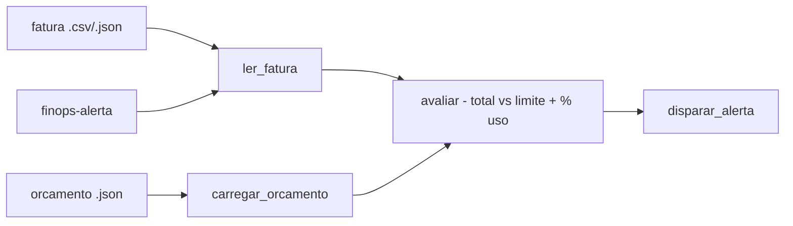

# finops-alerta-orcamento

[English](README.en.md) · **Português (Brasil)**

[](#) [](#) [](LICENSE)

## O que é

**Alerta de orçamento de nuvem (FinOps)**: lê uma **fatura simulada** (CSV ou JSON) e um **orçamento** (JSON), compara o total da fatura contra o limite e **dispara um alerta** com o percentual de uso. É um laboratório educacional de FinOps em Python puro (stdlib).

## Status

Laboratório educacional funcional e testado (14 testes).

## Funcionalidades

- **Leitura de fatura** (`alerta.py`): `ler_fatura_csv`/`ler_fatura_json` — aceita CSV (lista de itens) ou JSON.
- **Orçamento** (`carregar_orcamento`): lê o JSON de orçamento com o limite.
- **Avaliação** (`avaliar`): compara `Fatura.total` com o limite do `Orcamento` e calcula `percentual_uso`.
- **Disparo** (`disparar_alerta`): imprime o alerta quando o uso passa do limite.
- **CLI**: `finops-alerta <fatura> <orcamento>`.

## Arquitetura

Pacote `finops_alerta_orcamento` com `models.py` (Fatura/Orcamento/Alerta), `alerta.py` (leitura, avaliação, disparo) e `cli.py` (interface).



## Stack

- Python ≥ 3.10, stdlib apenas
- pytest (dev)

## Estrutura do repositório

```
finops-alerta-orcamento/
├── pyproject.toml · BRIEF.md
├── src/finops_alerta_orcamento/
│   ├── models.py    # Fatura/Orcamento/Alerta
│   ├── alerta.py    # leitura + avaliação + disparo
│   └── cli.py       # CLI
├── tests/           # 14 testes
└── LICENSE          # MIT
```

## Pré-requisitos e instalação

```bash
pip install -e .
```

## Como executar

```bash
finops-alerta fatura.csv orcamento.json
finops-alerta fatura.json orcamento.json
```

## Testes e qualidade

Comando real (verificado pelo agente):

```bash
PYTHONPATH=src python -m pytest tests/
# 14 passed
```

## Decisões técnicas e trade-offs

- **Fatura simulada local**: seguro e reprodutível, sem chaves de provedor de nuvem; em troca, não consulta APIs reais (AWS/GCP/Azure).
- **Percentual de uso no alerta**: dá contexto (quanto do limite foi consumido), não apenas sim/não.

## Limitações conhecidas e roadmap

- Não integra provedores de nuvem reais (fatura é arquivo local).
- Alerta impresso no stdout; sem envio por e-mail/webhook.

## Processo de desenvolvimento

Projeto individual de Kelvin Oliveira, construído com agentes de IA orquestrados e revisado pelo autor.

## Licença e autor

MIT — Copyright (c) 2026 Kelvin Rebelo de Oliveira. Autor: [Kelvin Oliveira](https://github.com/KelvinOliveiraCode) · [Portfólio](https://kelvinoliveiracode.github.io/portfolio/)
